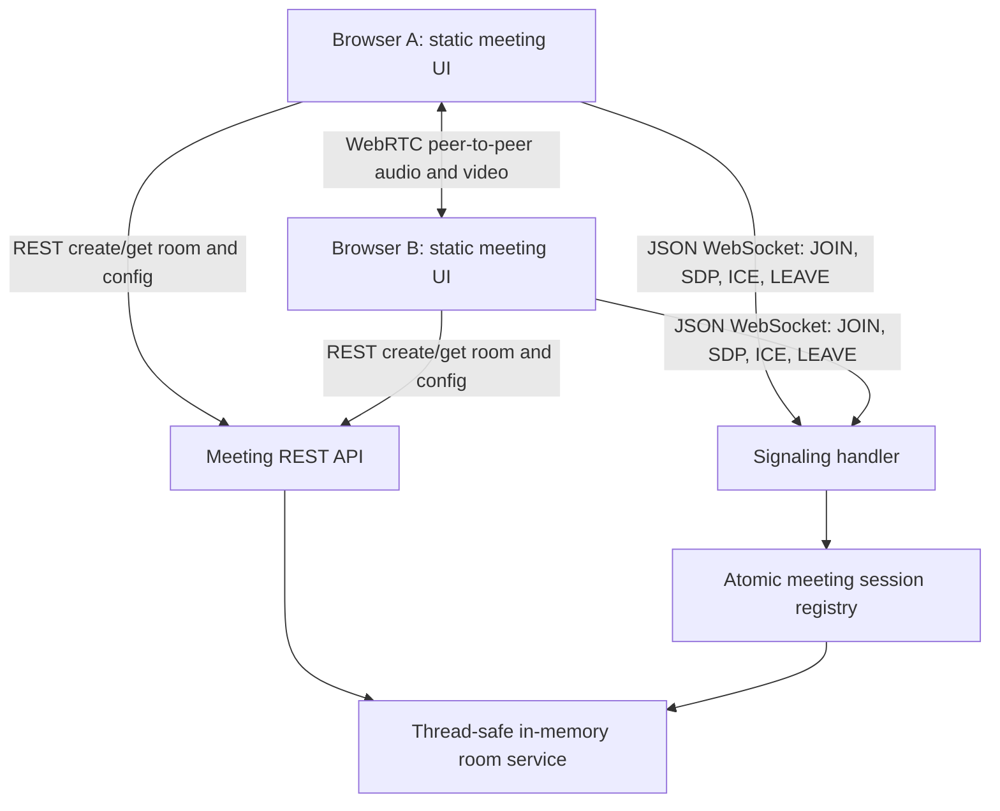
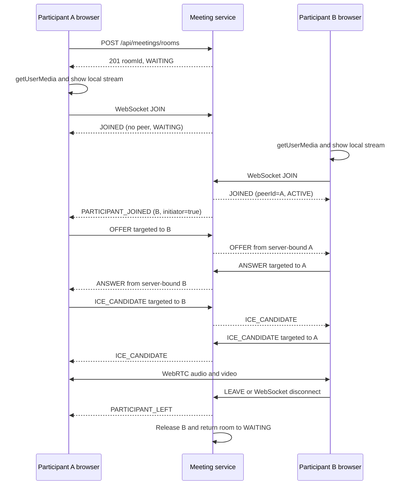
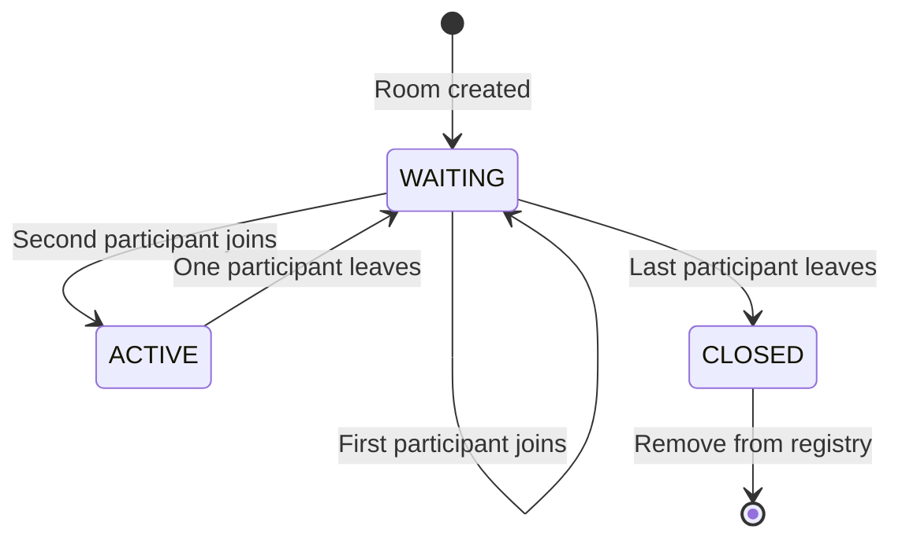

# Meeting Service MVP

## Overview

`meeting-service` is a local-development browser meeting MVP for exactly two participants in one
room. It supports room creation, camera and microphone capture, peer-to-peer audio/video, mute and
camera controls, leave notifications, and cleanup after explicit or unexpected disconnects.

The MVP intentionally does not include authentication, group calls, recording, screen sharing,
chat, scheduling, persistence, Redis, TURN, an SFU, or production deployment. Rooms and participant
bindings exist only in one application process and are lost on restart.

## Architecture

The dependency-free browser UI and the Spring Boot backend are packaged in the same service. The
browser uses REST to create or inspect rooms and a plain JSON WebSocket to exchange signaling data.
The backend validates and forwards SDP and ICE messages but never opens a media track and never
receives audio or video bytes. After negotiation, browsers exchange media directly through WebRTC.

The backend layers are:

- `domain`: room identifiers, participant identifiers, room state, and transitions;
- `application`: the thread-safe room service and atomic session/participant registry;
- `adapter/rest`: room and client-configuration APIs;
- `adapter/websocket`: typed signaling validation, session identity, and targeted forwarding;
- `infrastructure/config`: clock, WebSocket limits, origin policy, and externalized ICE settings.



## Connection Sequence

The server selects the existing first participant as the initiator when the second participant
joins. Only that participant creates the offer, which prevents simultaneous-offer glare.



## Room Lifecycle

A room starts empty in `WAITING`. The first participant keeps it in `WAITING`; the second moves it
to `ACTIVE`. A third concurrent join is rejected. If one participant leaves an active room, the
room returns to `WAITING`. If the last participant leaves, the room moves to `CLOSED` and is
immediately removed from the in-memory registry. Closed rooms cannot be joined.



Joining and leaving are WebSocket-owned operations. The service deliberately does not expose REST
join/leave endpoints, because two independent transports modifying the same occupancy would create
duplicate lifecycle and disconnect-compensation rules.

## REST API

### Create a room

```http
POST /api/meetings/rooms
```

Returns `201 Created` and a `Location` header.

```json
{
  "roomId": "a118d64f8dbb40bc9f205242b51453ef",
  "status": "WAITING",
  "maxParticipants": 2,
  "participantCount": 0,
  "createdAt": "2026-08-10T10:00:00Z"
}
```

### Get room information

```http
GET /api/meetings/rooms/{roomId}
```

Returns `200 OK`, or `404 Not Found` after an unknown/closed room is removed. Participant identities
are not exposed by REST; only the count is public.

### Get WebRTC client configuration

```http
GET /api/meetings/config
```

```json
{
  "iceServers": []
}
```

The default empty list supports two tabs on the same localhost host. Development STUN servers can
be configured in `application.yml`; they are returned to the client without hardcoding credentials
in JavaScript.

### Errors

Invalid identifiers return `400`, missing rooms return `404`, and room lifecycle conflicts return
`409` where REST applies.

```json
{
  "code": "ROOM_NOT_FOUND",
  "message": "Meeting room not found: room-missing",
  "timestamp": "2026-08-10T10:00:00Z"
}
```

Room and participant IDs must contain 8 to 64 ASCII letters, digits, underscores, or hyphens.

## WebSocket Protocol

Connect to the same-origin endpoint:

```text
ws://localhost:8084/ws/meetings
```

The browser first creates or obtains a room, opens the WebSocket, and sends `JOIN`. Protocol version
1 uses strict JSON objects: missing fields, unknown fields, client-provided server fields, and
fields belonging to another message type are rejected. A successful join creates a random
participant ID on the server and binds the WebSocket session to that ID and one room. For every
later message, the server derives the sender from this binding; clients never send `senderId` or
`timestamp`.

### Client-to-server messages

| Type | Required fields | Purpose |
| --- | --- | --- |
| `JOIN` | `version`, `type`, `roomId` | Atomically occupy a participant slot. Duplicate JOIN on the same socket and room returns the same identity. |
| `OFFER` | base fields, `targetId`, `payload.sdp` | Send an SDP offer to the room peer; only the server-selected offerer is accepted. |
| `ANSWER` | base fields, `targetId`, `payload.sdp` | Send an SDP answer from the selected answerer. |
| `ICE_CANDIDATE` | base fields, `targetId`, exact candidate payload | Send one ICE candidate to the same-room peer. |
| `LEAVE` | `version`, `type`, `roomId` | Idempotently release this session's participant binding. |
| `PING` | `version`, `type`, `roomId` | Verify that signaling is responsive for a joined session. |

JOIN example:

```json
{
  "version": 1,
  "type": "JOIN",
  "roomId": "a118d64f8dbb40bc9f205242b51453ef"
}
```

Offer and answer payloads have one non-blank `sdp` field:

```json
{
  "version": 1,
  "type": "OFFER",
  "roomId": "a118d64f8dbb40bc9f205242b51453ef",
  "targetId": "98cb62bf70ef44dd8022d30e5993f52c",
  "payload": {"sdp": "v=0..."}
}
```

ICE payloads require a non-blank candidate, a non-blank `sdpMid`, and a non-negative
`sdpMLineIndex`:

```json
{
  "version": 1,
  "type": "ICE_CANDIDATE",
  "roomId": "a118d64f8dbb40bc9f205242b51453ef",
  "targetId": "98cb62bf70ef44dd8022d30e5993f52c",
  "payload": {
    "candidate": "candidate:...",
    "sdpMid": "0",
    "sdpMLineIndex": 0
  }
}
```

SDP is limited to 49,152 characters. A candidate is limited to 4,096 characters, `sdpMid` to 64,
and the integral `sdpMLineIndex` to 0 through 128. The whole UTF-8 message is limited to 65,536
bytes. Client messages use exact per-type fields; `senderId`, `timestamp`, and extra payload fields
are rejected as server-owned or unknown data.

### Server-to-client messages

| Type | Purpose |
| --- | --- |
| `JOINED` | Confirms the server identity and reports `participantId`, optional `peerId`, room status, and the deterministic `initiator` role. |
| `PARTICIPANT_JOINED` | Tells the existing peer to initiate negotiation. |
| `OFFER` | Validated offer forwarded only to `targetId`. |
| `ANSWER` | Validated answer forwarded only to `targetId`. |
| `ICE_CANDIDATE` | Validated candidate forwarded only to `targetId`. |
| `PARTICIPANT_LEFT` | Reports explicit leave or unexpected disconnect. |
| `ROOM_FULL` | Rejects a third participant without retaining a binding. |
| `ERROR` | Controlled protocol or identity error with `code` and `message`. |
| `LEFT` | Confirms idempotent leave with `payload.released`. |
| `PONG` | Response to `PING`. |

Example controlled error:

```json
{
  "version": 1,
  "type": "ERROR",
  "roomId": null,
  "senderId": null,
  "targetId": null,
  "payload": {
    "code": "CROSS_ROOM_SIGNALING",
    "message": "Sender and target must belong to the same room"
  },
  "timestamp": "2026-08-10T10:00:03Z"
}
```

Malformed JSON, oversized messages, unsupported versions/types, invalid or unknown fields,
unbound senders, missing targets, wrong negotiation roles, and cross-room targets are rejected.
Full SDP and ICE contents, room IDs, participant IDs, session IDs, tokens, and media are not logged
by the signaling handler.

## WebRTC Lifecycle

1. The browser loads the externalized ICE-server list.
2. `getUserMedia({video: true, audio: true})` obtains and displays the local stream.
3. A peer connection is created when a peer appears or a valid signal from the selected peer arrives.
4. Every local track is added with `addTrack` and the remote stream is attached from `ontrack`.
5. The existing first participant creates the offer after `PARTICIPANT_JOINED`.
6. The second participant applies the offer, creates an answer, and returns it through signaling.
7. Both clients exchange ICE candidates. Candidates received before `remoteDescription` are
   deduplicated, queued up to 128 entries, and flushed after the remote offer or answer is applied.
   The recent-candidate set is bounded at 512 entries.
8. Microphone and camera buttons change the matching `MediaStreamTrack.enabled` flag.
9. Duplicate descriptions and candidates, stale peer signals, and the non-selected peer's offer are
   ignored or rejected without mutating the active negotiation. Only the selected first
   participant can initiate a renegotiation offer.
10. Leave closes the peer connection and WebSocket, stops local tracks, clears both video elements,
    and empties bounded protocol state. An unexpected socket close performs the same local cleanup.

The UI reports distinct `Waiting`, `Connecting`, `Connected`, `Reconnecting`, `Degraded`,
`Participant left`, `Disconnected`, and `Failed` states. Automatic reconnect, ICE restart, and
quality adaptation are later milestones; the states do not claim those mechanics exist yet.

STUN discovers network candidates; it does not relay media and does not replace TURN.

## Local Development

Prerequisites are JDK 21, the repository Gradle wrapper, Node.js 18 or newer for frontend unit
tests, and a browser with camera/microphone support.

Run directly:

```bash
./gradlew :meeting-service:bootRun
```

Or build and run the isolated Compose service:

```bash
docker compose up -d --build meeting-service
```

Then open http://localhost:8084. Camera and microphone access works on `localhost`, which browsers
treat as a secure context. To add a development STUN server, change the external configuration:

```yaml
meeting:
  ice-servers:
    - urls: stun:stun.example.test:3478
```

The WebSocket origin allowlist defaults to `http://localhost:8084` and
`http://127.0.0.1:8084`. Add an exact local frontend origin under `meeting.allowed-origins` if a
different local host or port is intentionally used.

### Two-tab manual verification

1. Open tab A, click **Create room**, and grant camera and microphone access.
2. Copy the generated local link and open it in tab B.
3. Click **Join room** in tab B and grant media permissions.
4. Confirm that both tabs show local and remote video and report `Connected`.
5. Mute tab A, disable the camera in tab B, and then re-enable both.
6. Leave from tab B and confirm that tab A reports `Participant left`.
7. Join the still-waiting room again from tab B.
8. While A and B are active, try the link in tab C and confirm the room-full error.
9. Refresh one joined tab and confirm the other receives `Participant left`; rejoin from the
   refreshed tab.
10. Inspect backend logs and storage: only room/session metadata exists, with no media or recording.

Use headphones or mute one browser tab to prevent acoustic echo on one device.

## Testing

Backend checks:

```bash
./gradlew :meeting-service:checkstyleMain :meeting-service:checkstyleTest
./gradlew :meeting-service:compileJava :meeting-service:compileTestJava
./gradlew :meeting-service:test
./gradlew :meeting-service:bootJar
```

Frontend checks:

```bash
cd meeting-service
npm run lint
npm test
npm run build
npm run test:e2e
```

`npm run test:e2e` uses the system Chrome channel with fake camera and microphone devices. It starts
the service automatically unless `MEETING_E2E_EXTERNAL_SERVER=true` is set. The browser suite uses
isolated contexts and asserts live remote audio/video tracks, media controls, third-user rejection,
refresh cleanup, and reuse of the released slot.

Backend tests cover lifecycle transitions, duplicate/full rooms, cleanup, invalid transitions, a
concurrent final-slot race, REST contracts, real WebSocket connection and forwarding, strict and
oversized protocol messages, unknown participants, cross-room isolation, deterministic roles,
duplicate lifecycle requests, failed-join compensation, and disconnect cleanup. Frontend unit
tests cover permissions, audio constraints, deterministic and repeated negotiation, duplicate and
bounded early ICE, controls, state transitions, stale messages, room-full handling, and full
cleanup. Playwright fake-media tests prove the browser WebRTC path on the installed Chrome build;
they do not replace a physical-device and cross-network test.

## Security Considerations

- A server-generated participant identity is reserved atomically and bound to one WebSocket
  session and room; duplicate join/leave operations are idempotent.
- Client-provided sender IDs and timestamps are rejected, not used as authority.
- Targets must have an active binding in the same room; signals are never globally broadcast.
- Room occupancy is synchronized and cannot exceed two even under concurrent joins.
- Version, exact field set, type, identifier, target, negotiation role, and type-specific payload
  fields and sizes are validated before forwarding.
- UTF-8 messages are capped at 65,536 bytes and malformed JSON returns a controlled error.
- The origin allowlist uses explicit same-origin local URLs rather than `*`.
- Signaling logs contain event/signal type and participant count, but omit room, participant and
  session IDs, SDP, ICE payloads, tokens, IP addresses, credentials, and media.
- The current project authentication is incomplete, so this local MVP isolates anonymous random
  participant IDs at the WebSocket boundary. Production must use an authenticated principal and
  authorize room membership.

## Production Considerations

A production version requires HTTPS and secure WebSocket (`wss`), authenticated and authorized
participants, expiring room capabilities, rate limits, abuse controls, and a production origin
policy. Real-world NAT/firewall traversal requires TURN, commonly coturn or a managed equivalent,
in addition to STUN. TURN credentials must be short-lived and supplied securely.

Multiple service replicas require a distributed room/session registry such as Redis, signaling
fan-out between nodes, and either sticky sessions or WebSocket-aware routing. Add metrics for room
occupancy, signaling failures, negotiation time, ICE failures, and disconnect causes. For more than
two participants, migrate media to an SFU instead of extending this peer-to-peer design into a mesh.

## Troubleshooting

### Camera or microphone permission denied

Allow camera and microphone access for `http://localhost:8084` in browser site settings, close any
application holding the device exclusively, and join again.

### Remote video does not appear

Confirm both clients joined the exact same room, both local previews work, neither tab reports a
WebSocket error, and browser autoplay is allowed. Check the browser WebRTC diagnostics and backend
signal-type logs; the backend intentionally has no media logs.

### ICE connection fails

Two tabs on the same host normally work with an empty ICE list. Two devices or restrictive networks
may need STUN and, in production, TURN. STUN alone cannot traverse every NAT or firewall.

### WebSocket connection fails

Confirm the service is running on port 8084, use the UI from an allowed exact origin, and check
`http://localhost:8084/actuator/health`. Reverse proxies must support HTTP Upgrade for WebSocket.

### Room is full

Only two active WebSocket bindings are allowed. Leave or close one participant and retry. An
unexpected disconnect releases its slot through `afterConnectionClosed`.

### Browser autoplay is blocked

Click the remote video or interact with the page. Local video is muted so that it can autoplay.

### Testing from two devices

`localhost` points to each device itself, and camera access on a plain LAN HTTP address may be
blocked as an insecure context. This MVP is scoped to one local machine. Cross-device testing needs
an HTTPS development origin, matching WebSocket origins, reachable host networking, and suitable
STUN/TURN configuration.
