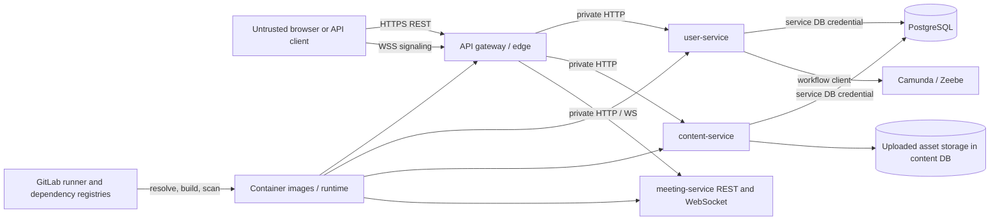

# Advent Academy threat model

## Control

- **Scope:** API gateway, user-service, content-service, meeting-service, PostgreSQL, Camunda local
  integration, uploaded content, CI/CD, and container runtime.
- **Assessment date:** 2026-08-31.
- **Assessed commit:** `131a624`.
- **Method:** data-flow review plus STRIDE.
- **Review trigger:** new external route, trust boundary, identity mechanism, file type, datastore,
  third-party integration, deployment topology, or material authorization change.

## Security objectives

1. Only user-service can authenticate credentials and issue access tokens.
2. Every resource service authenticates requests and authorizes the requested object and action.
3. Untrusted content cannot execute with the application origin's authority.
4. Sessions, MFA, recovery, and meeting capabilities are confidential, revocable, and replay-safe.
5. Administrative and content-publication actions are attributable to a verified actor.
6. Operational interfaces, secrets, and internal service/data ports are not internet-exposed.
7. Security controls fail closed and remain effective across restart and horizontal scaling.

## System and trust boundaries

Trust boundaries:

- **TB-1 Internet to edge:** all request data, origins, identifiers, files, and forwarding headers are
  attacker-controlled.
- **TB-2 Edge to services:** routing does not imply authentication; services remain independently
  responsible for token and resource checks.
- **TB-3 Service to data/workflow:** database and Camunda identities are separate, least-privilege
  principals. Workflow variables are untrusted orchestration input, not actor identity.
- **TB-4 Uploaded content to browser:** Markdown, SVG, documents, filenames, MIME declarations, and
  archives are attacker-controlled active-content candidates.
- **TB-5 Build to runtime:** dependency registries, CI variables, build cache, base images, artifacts,
  and runner/Docker daemon are a software-supply-chain boundary.
- **TB-6 Operations:** actuator, metrics, Swagger, debug ports, logs, audit data, and secret stores are
  restricted administration surfaces.

## Assets

| Asset | Security requirement |
| --- | --- |
| Password hashes and credentials | confidentiality, resistant verification, no logging |
| JWT private keys and encryption keys | confidentiality, rotation, least privilege |
| Access/refresh tokens and session families | confidentiality, integrity, expiry, revocation, replay detection |
| MFA seeds, recovery codes, verification/reset tokens | encryption or hashing, single use, expiry, no disclosure |
| User profiles, roles, permissions, role requests | confidentiality, integrity, admin/self authorization, auditability |
| Draft and published course structures | object authorization, publication integrity, availability |
| Markdown and uploaded assets | ownership, type/size validation, non-executable delivery |
| Meeting rooms, membership, capabilities, signaling | confidentiality, membership authorization, replay/abuse resistance |
| Audit evidence and logs | integrity, bounded/redacted data, controlled retention/access |
| Database, Camunda, CI, images, and operational endpoints | least privilege, integrity, restricted reachability |

## Actors and attacker profiles

- Anonymous internet client.
- Authenticated learner attempting horizontal or vertical privilege escalation.
- Content editor attempting cross-owner access or unsafe publication.
- Compromised account, browser, service, dependency, CI job, or container.
- Malicious uploaded-content author.
- Network attacker at an incorrectly terminated HTTP/WS boundary.
- Operator or administrator making an accidental unsafe configuration change.

## Principal data flows

| Flow | Input crossing boundary | Required controls |
| --- | --- | --- |
| Registration/login/recovery | credentials, email, MFA, tokens, IP metadata | rate limit, non-enumeration, audit, token secrecy |
| Access-token verification | bearer JWT and JWKS | algorithm/issuer/audience/type/expiry/kid validation, key rotation |
| Content construction/publication | IDs, text, status changes | authenticated actor, object grant, lifecycle rules, audit |
| Markdown/assets | multipart bytes, name, MIME, archive paths, HTML | byte-based type validation, limits, sanitizer, isolation, ownership |
| Meeting control | room/member IDs and capability requests | server-derived subject, host/member policy, quotas |
| WebSocket JOIN/signaling | origin, capability, JSON, SDP/ICE | exact origin, one-time grant, size/schema/rate limits, bounded state |
| Operations | health, metrics, routes, docs, debug | private reachability, minimal disclosure, explicit local exceptions |
| Build/release | source, dependencies, images, CI secrets | protected runners, scans, SBOM, immutable artifacts, provenance |

## STRIDE threats and treatment

| Threat | Category | Scenario | Treatment |
| --- | --- | --- | --- |
| T-01 | Spoofing | Attacker forges or confuses access/refresh JWT type or algorithm | SEC-104 |
| T-02 | Spoofing | Service holding a shared HMAC verification secret mints access tokens | SEC-104 |
| T-03 | Spoofing | Path/body user ID is used as actor identity | SEC-102 and SEC-109 |
| T-04 | Tampering | Anonymous or under-privileged user changes/publishes course content | SEC-102 |
| T-05 | Tampering | Workflow variables or concurrent refresh alter protected state | SEC-103 and SEC-104 |
| T-06 | Repudiation | Content, role, recovery, or meeting actions lack a verified audit actor | SEC-109 |
| T-07 | Information disclosure | Draft/private content or asset is retrieved by UUID | SEC-102 |
| T-08 | Information disclosure | Tokens, MFA seeds, SDP/ICE, file data, or PII enter logs/audit | SEC-103 and SEC-109 |
| T-09 | Information disclosure | Actuator, metrics, routes, Swagger, or debug ports expose internals | SEC-106 and SEC-108 |
| T-10 | Denial of service | Auth endpoints are brute-forced or exhausted | SEC-103 and SEC-106 |
| T-11 | Denial of service | ZIP bombs, large files, signal floods, or unbounded rooms consume resources | SEC-105 and SEC-107 |
| T-12 | Elevation of privilege | Missing content-service security permits anonymous editor/admin actions | SEC-102 |
| T-13 | Elevation of privilege | IDOR crosses course/lesson/asset ownership | SEC-102 |
| T-14 | Elevation of privilege | Stored SVG/HTML/polyglot executes in application origin | SEC-105 |
| T-15 | Spoofing / replay | Refresh token, TOTP, recovery token, or meeting capability is replayed | SEC-103, SEC-104, SEC-107 |
| T-16 | Tampering | Wildcard/incorrect origin admits hostile WebSocket/browser traffic | SEC-106 and SEC-107 |
| T-17 | Tampering | Forged forwarding/request-ID headers corrupt attribution or logs | SEC-106 and SEC-109 |
| T-18 | Elevation of privilege | Shared DB/runtime credentials expand one-service compromise | SEC-108 |
| T-19 | Tampering | Vulnerable dependency, mutable image, or compromised build contaminates release | SEC-110 |
| T-20 | Repudiation | Application can modify/delete its own audit evidence | SEC-109 |

No listed threat is accepted indefinitely. Current open risks and owners are maintained in
[`risk-register.md`](risk-register.md).

## Priority abuse cases

1. An anonymous caller invokes constructor endpoints directly and publishes attacker-controlled
   course content.
2. A learner guesses a draft course, lesson, or asset UUID and reads or mutates it without an
   ownership check.
3. An uploader supplies script-capable SVG or a MIME polyglot that is served inline from the
   application origin.
4. An attacker replays refresh tokens, recovery tokens, TOTP codes, or meeting capabilities during
   a race or after a service restart.
5. A compromised resource service uses the shared HMAC secret to mint administrator access tokens.
6. A hostile origin opens signaling connections or floods messages/rooms until local state is
   exhausted.
7. An unauthenticated caller enumerates gateway routes, detailed health, metrics, API schemas, or a
   debugger and uses the information to pivot.
8. A malicious dependency or mutable base image enters a release without a blocking security gate.

## Assumptions and limits

- The current Docker Compose file is local-development infrastructure, not a production topology.
- TLS/WSS termination and a production secret manager do not yet exist in this repository.
- Meeting state and refresh-token state are process-local at the baseline and therefore not approved
  for multi-instance production.
- Green functional tests do not prove authorization, active-content isolation, abuse resistance, or
  production configuration safety.
- This model covers application/platform design. It does not replace an external penetration test or
  cloud-provider-specific infrastructure threat model.
