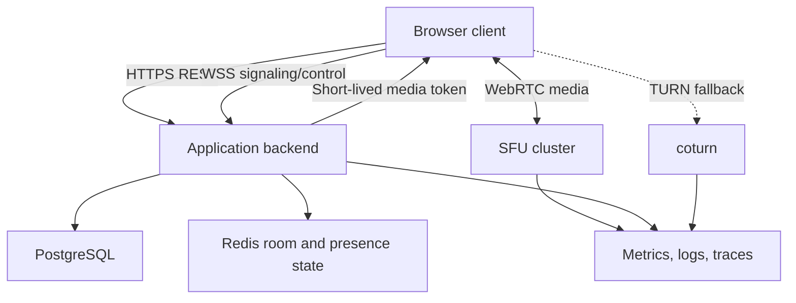

# Codex task: production-ready audio/video conferencing

You are working in an existing repository that already contains a local MVP of a two-person WebRTC room. Your task is to inspect the real implementation and evolve it, milestone by milestone, into a stable production-oriented audio/video conferencing service.

This is a long-running engineering task. Do not attempt to implement everything as one unreviewable change. First inspect the repository, then create an executable plan, and implement one milestone at a time. Each milestone must have its own tests, documentation update, verification results, and explicit completion gate.

## 1. Product goal

Build a browser-based conferencing service with these priorities, in order:

1. Stable audio communication between two participants.
2. Stable video communication between two participants.
3. Reliable operation over the public internet, including restrictive NAT and firewalls.
4. Graceful degradation on weak or unstable networks, with audio always taking priority over video.
5. Group conferencing if it can be delivered safely through a proven SFU architecture.
6. Production security, observability, failure recovery, deployment, and operational documentation.

Meeting recording is not required now. However, introduce a small, clean recording extension point so recording can be added later without redesigning the room domain or coupling the application to one media provider. Do not implement recording, store media, or expose a fake working recording API.

The completed system must remain testable on one computer using multiple tabs, browser contexts, or automated browsers with fake media devices. Production verification must additionally cover separate devices and separate networks where the environment permits it.

## 2. Mandatory initial analysis

Before modifying code:

1. Read every applicable `AGENTS.md` from repository root to the target modules.
2. Inspect Git status and preserve all unrelated changes.
3. Inspect the complete repository structure and identify:
   - frontend modules and framework;
   - backend modules and framework;
   - Java, Spring Boot, Node, package-manager, and browser-support versions;
   - current room domain and lifecycle;
   - REST and WebSocket signaling contracts;
   - current WebRTC negotiation strategy;
   - authentication and authorization model;
   - existing P2P, STUN, TURN, or SFU configuration;
   - current persistence, Redis, Docker, reverse proxy, CI, metrics, tracing, and logging;
   - test frameworks and exact build/lint/test commands;
   - existing technical documentation and Mermaid diagrams.
4. Run the relevant existing checks before changes and record the baseline. Distinguish pre-existing failures from regressions.
5. Identify whether the current two-person MVP genuinely works or only has unit tests. Do not claim browser media verification unless it was actually performed.
6. Produce a short architecture assessment containing:
   - what can be retained;
   - what must be corrected;
   - important security or concurrency risks;
   - whether P2P is currently sufficient for the two-person milestone;
   - the recommended SFU integration boundary for group calls.

If a decision materially depends on missing business information, ask one focused question. For ordinary technical choices, make and document a defensible decision instead of blocking.

## 3. Planning and progress files

Create or update repository-appropriate files equivalent to:

```text
docs/plans/video-conferencing-production-plan.md
docs/video-conferencing.md
```

The plan is the source of truth for milestone status. It must contain:

- current baseline;
- target architecture;
- milestone checklist;
- expected files/modules affected by each milestone;
- dependencies and risks;
- decisions and short ADR-style rationale;
- commands and actual verification results;
- known limitations;
- next unfinished action.

Keep the plan updated throughout the work. Mark a milestone complete only when its completion gate passes. Technical documentation, code comments, diagrams, API descriptions, operational runbooks, and ADRs must be written in English.

## 4. Architecture decision rules

### 4.1 Two participants

For exactly two participants, the existing P2P WebRTC implementation may be retained if it is secure, stable, observable, and supports TURN fallback. Do not route media through the Java application backend.

### 4.2 Group conferences

Do not implement browser mesh for group calls. For more than two participants, use an SFU. Prefer a mature self-hostable solution such as LiveKit unless the repository already uses another proven SFU or its constraints make another option clearly better.

Before integrating an SFU:

- compare the existing architecture with LiveKit, Janus, Jitsi, and mediasoup only as needed;
- choose one solution and document the reason;
- prefer official server/client SDKs over custom protocol implementations;
- keep provider-specific code behind an internal media-session abstraction;
- do not build a custom SFU, RTP router, congestion controller, or media server;
- do not silently add a cloud-paid dependency when a self-hosted development path is required.

Recommended target topology:



Adapt the final diagram to the actual implementation. If the two-person path remains P2P while group rooms use an SFU, document both paths explicitly and prove that the resulting complexity is justified. A single SFU path for both two-person and group rooms is acceptable when operational simplicity and reliability outweigh the extra infrastructure.

### 4.3 Backend responsibility

The application backend owns:

- authenticated meeting creation and access policy;
- room metadata and lifecycle;
- participant authorization and roles;
- short-lived media access tokens;
- signaling/control integration that belongs outside the SFU;
- audit events without sensitive media payloads;
- rate limiting and abuse controls;
- observability and operational APIs.

The backend must not decode, proxy, or persist live audio/video unless a future explicitly approved recording or media-processing feature requires it.

## 5. Non-functional priorities

Implement and evaluate in this order:

1. Audio continuity and intelligibility.
2. Correct room isolation and identity.
3. Connection recovery and cleanup.
4. Video continuity.
5. Video resolution and frame rate.
6. Visual polish.

Never preserve high-resolution video at the cost of broken audio.

## 6. Milestone 0 — baseline, threat model, and execution plan

Deliver:

- repository assessment;
- baseline test results;
- current and target architecture diagrams;
- data-flow diagram identifying trust boundaries;
- concise threat model;
- decision on P2P versus SFU path;
- phased implementation plan with rollback points.

Threat model must cover at least:

- room ID guessing and unauthorized joins;
- WebSocket/session impersonation;
- token theft and replay;
- cross-room signaling;
- malicious SDP/ICE payload sizes;
- denial of service through room creation, joins, signaling, and TURN usage;
- origin and CORS abuse;
- log leakage of tokens, SDP, IP addresses, or personal data;
- dependency and container risks;
- meeting link sharing and revoked access.

Completion gate:

- baseline commands were actually executed;
- architecture choice and risks are documented;
- no product code has been broadly rewritten without evidence.

## 7. Milestone 1 — harden the existing two-person room

Make the current local two-person call deterministic and safe before adding infrastructure.

Required behavior:

- exactly two active participants maximum;
- atomic join/leave and no race that permits a third participant;
- server-bound participant identity rather than trusted client `senderId`;
- strict typed signaling messages and per-type validation;
- explicit message-size limits;
- same-room sender/target validation;
- deterministic offerer or correct perfect-negotiation implementation;
- queue ICE candidates received before remote description;
- handle duplicate, reordered, and late control messages safely;
- idempotent leave and cleanup;
- cleanup after tab close, refresh, WebSocket failure, and browser crash;
- correct UI states for waiting, connecting, connected, reconnecting, degraded, disconnected, and failed;
- microphone, camera, and leave controls;
- no full SDP, token, credential, or media data in logs.

Tests must include:

- room state transitions;
- concurrent joins for the last slot;
- duplicate joins and leaves;
- malformed and oversized messages;
- cross-room signaling rejection;
- unknown sender and target;
- offer/answer/ICE routing;
- disconnect cleanup;
- early ICE queue;
- glare/renegotiation scenario;
- device permission rejection;
- media-control cleanup.

Completion gate:

- all relevant backend and frontend checks pass;
- an automated or documented manual two-tab call succeeds;
- a third tab receives a non-blocking, understandable room-full error;
- refresh/disconnect releases the participant slot;
- no new security weakening is present.

## 8. Milestone 2 — authentication and meeting authorization

Integrate with the repository's existing authentication. If authentication does not exist, add the smallest production-suitable mechanism consistent with the project rather than inventing a parallel identity system.

Required behavior:

- authenticated user identity is the source of participant identity;
- meeting creator/host and participant roles are explicit;
- room access policy is enforced server-side;
- media/signaling tokens are short-lived, scoped to one room and one identity, and cannot be reused across rooms;
- token expiry, revocation, clock skew, and reconnect are handled;
- room IDs are unguessable and are not themselves authorization;
- repeated failed joins and room creation are rate-limited;
- secrets are externalized and never committed;
- authorization tests prove users cannot impersonate others or enter inaccessible rooms.

Keep public-link meetings optional and explicit. If supported, use a separate revocable invite token with expiry, not only a room ID.

Completion gate:

- unauthorized and cross-room access tests pass;
- tokens expire and are scoped correctly;
- existing application security remains intact;
- sensitive data does not appear in client logs, server logs, URLs, or metrics labels.

### Post-Milestone 2 browser media UX increment

The following local-only media enhancements were added before Milestone 3 at explicit product
request. They do not change the milestone order or make the service internet-ready:

- foreground-segmented background blur replaces only the outbound camera track and falls back to
  the original camera if initialization fails;
- browser noise suppression is enabled by default and can be toggled during a call;
- Web Audio level analysis highlights the local or remote video frame while that participant is
  speaking, with release hysteresis to prevent border flicker;
- all processing remains in the browser; no audio levels, camera frames, or processed media are
  sent to the Java backend.

## 9. Milestone 3 — HTTPS/WSS, STUN, TURN, and internet connectivity

Add production network traversal and secure transport.

Required infrastructure:

- HTTPS for frontend/API;
- WSS for signaling/control;
- configurable STUN servers;
- coturn or an approved managed TURN equivalent;
- UDP and TCP/TLS TURN paths for restrictive networks;
- short-lived TURN credentials generated server-side, preferably REST API time-limited credentials;
- no static TURN password in frontend bundles;
- health checks and metrics for TURN reachability and allocation failures;
- documented firewall ports and reverse-proxy behavior.

Required verification:

- same-computer two-tab call;
- two devices on the same LAN;
- two devices on different networks;
- forced relay test using `iceTransportPolicy: "relay"` in a test-only configuration;
- restrictive or simulated network path when practical;
- certificate, origin, and secure-context checks;
- confirmation through WebRTC diagnostics that the intended candidate type was selected.

Do not expose test-only relay switches in production UI.

Completion gate:

- direct connection works where possible;
- TURN relay works when direct connectivity is unavailable;
- credentials are short-lived and absent from source control;
- WSS and HTTPS are verified;
- operational troubleshooting is documented.

## 10. Milestone 4 — network-quality telemetry and adaptive degradation

Implement a network-quality subsystem based primarily on WebRTC statistics, not only WebSocket ping.

Collect relevant values through `RTCPeerConnection.getStats()` at a controlled interval, for example every 2 seconds, without high-cardinality metrics or UI churn. Depending on browser support, derive:

- round-trip time;
- inbound and outbound packet loss;
- available outgoing bitrate;
- actual audio/video bitrate;
- jitter;
- frames sent, received, dropped, and decoded;
- frame width, height, and frames per second;
- ICE candidate pair and connection state;
- freeze or quality-limitation indicators where available.

WebSocket heartbeat latency may be displayed as control-plane health but must not be mistaken for media RTT.

### 10.1 Quality model

Create a small tested quality evaluator with states such as:

```text
GOOD
FAIR
POOR
CRITICAL
OFFLINE
```

Do not rely on one sample. Use rolling windows, smoothing, consecutive-sample thresholds, and hysteresis. Recovery must require sustained improvement so the client does not oscillate between profiles.

Start with documented configurable thresholds rather than pretending universal values exist. A reasonable initial baseline to validate and tune is:

| State | Example indicators |
| --- | --- |
| GOOD | RTT below 150 ms, loss below 2%, stable bitrate |
| FAIR | RTT 150-300 ms or loss 2-5% |
| POOR | RTT 300-600 ms, loss 5-10%, repeated freezes, or insufficient outgoing bitrate |
| CRITICAL | RTT above 600 ms, loss above 10-15%, persistent ICE instability, or audio impairment risk |
| OFFLINE | failed/disconnected beyond the configured recovery window |

Thresholds must be externalized or centrally configured, unit-tested at boundaries, and documented as initial operational defaults that require real telemetry tuning.

### 10.2 Adaptation ladder

Adapt the affected participant's outgoing video only. Do not punish all participants because one participant has a weak uplink. With an SFU, use simulcast/SVC and subscriber-side layer selection where supported.

Implement an ordered degradation ladder similar to:

1. Normal: target up to 720p/30 fps within configured bitrate.
2. Reduced bitrate: lower video sender `maxBitrate`.
3. Reduced frame rate: for example 15 fps.
4. Reduced resolution: for example 360p.
5. Minimum video: low resolution and low frame rate.
6. Audio-only: disable/unpublish outgoing video while preserving the camera intent separately.

Use `RTCRtpSender.setParameters()` and/or the selected SFU SDK's supported adaptive-stream and simulcast controls. Do not reacquire camera/microphone streams on every profile change. If a browser rejects a parameter change, handle it safely and report telemetry without dropping the call.

Recovery must climb the ladder gradually after a stable recovery window. Do not immediately restore full video after one good sample.

### 10.3 Audio priority

Audio must remain enabled throughout automatic video degradation unless the user explicitly mutes it or the connection is completely unavailable.

Required audio behavior:

- use WebRTC audio processing supported by the browser, such as echo cancellation, noise suppression, and automatic gain control where appropriate;
- prefer Opus and normal WebRTC congestion control;
- avoid setting an unnecessarily high audio bitrate;
- never automatically mute or disable audio to preserve video;
- reduce or suspend video before audio becomes unintelligible;
- do not claim absolute audio quality can be guaranteed under zero bandwidth; communicate that the system prioritizes audio and degrades video first.

### 10.4 User notification

Show a non-modal, non-blocking warning inside the call UI for the affected participant. It must not cover video controls or terminate the call.

Example meanings:

- "Your connection is unstable. Video quality has been reduced to keep audio clear."
- "Your video was paused because the network is very weak. Audio remains active."
- "Connection quality has recovered. Video is being restored."

The notification must:

- identify whether the problem is local/uplink, remote/downlink, or unknown when the data supports that distinction;
- show a compact network indicator with accessible text, not color alone;
- be debounced so it does not flash repeatedly;
- be dismissible where appropriate while the small indicator remains;
- never block the meeting;
- not expose internal diagnostics to ordinary users;
- provide an optional diagnostics panel for support/development.

### 10.5 Tests

Add deterministic tests for:

- quality-state boundaries;
- rolling-window calculation;
- hysteresis and recovery delay;
- degradation step order;
- audio never being disabled by adaptation;
- automatic video pause at critical quality;
- gradual video restoration;
- no oscillation under alternating samples;
- browser API failure during `setParameters()`;
- notification debounce and accessibility;
- independent adaptation for different participants.

Add a development-only network simulation procedure using browser throttling, Linux traffic control, a proxy, or test doubles, depending on the environment. Never run destructive host-wide network commands without explicit permission.

Completion gate:

- weak-network simulation visibly lowers video before audio is affected;
- critical conditions switch to audio-only without ending the call;
- the affected user sees a non-blocking warning;
- recovery is gradual and stable;
- metrics and tests show why each transition occurred.

## 11. Milestone 5 — reconnection and fault recovery

Handle transient failures as explicit state machines rather than scattered timers.

Required behavior:

- heartbeat and stale-session detection;
- bounded exponential backoff with jitter;
- WebSocket reconnection;
- ICE restart when appropriate;
- SFU reconnect/resume using official SDK capabilities;
- token refresh before expiry;
- idempotent participant rejoin;
- duplicate-session policy;
- cleanup after recovery timeout;
- user-visible reconnecting state that does not immediately destroy local media;
- clear terminal failure state and manual retry;
- browser offline/online event handling;
- backend instance restart behavior;
- Redis/SFU/TURN unavailability behavior.

Do not implement infinite tight retry loops. Ensure cancellation on leave and page teardown.

Test with controlled failures:

- signaling connection interrupted and restored;
- temporary ICE disconnect;
- network offline/online;
- expired media token;
- backend restart;
- SFU process restart where supported;
- Redis interruption;
- duplicate reconnect messages;
- leave while reconnecting.

Completion gate:

- short interruptions recover automatically within a documented window;
- unrecoverable failures terminate cleanly;
- no ghost participant remains;
- no duplicate media tracks or peer connections appear after reconnect.

## 12. Milestone 6 — persistence and distributed room/presence state

Separate durable meeting metadata from ephemeral connection state.

Use PostgreSQL for durable data such as:

- meeting identity;
- creator and access policy;
- lifecycle timestamps;
- optional scheduled metadata if already in scope;
- audit-safe participant join/leave facts where legally and product-appropriate.

Use Redis or the selected SFU's supported distributed primitives for:

- active participant presence;
- short-lived session mappings;
- heartbeats and TTL cleanup;
- distributed locks or atomic capacity enforcement where required;
- routing hints across backend instances.

Requirements:

- database migrations are additive and tested;
- no media, SDP, ICE candidate, access token, or TURN credential persistence;
- TTLs clean stale presence;
- capacity checks remain atomic across application instances;
- service restart does not corrupt room lifecycle;
- clock handling uses UTC and explicit expiry semantics.

Completion gate:

- two backend instances cannot overfill a room;
- stale presence expires;
- durable metadata survives restart;
- ephemeral data is not misused as permanent history.

## 13. Milestone 7 — group conferencing through an SFU

Begin this milestone only after milestones 1-6 meet their gates.

Implement group rooms through the selected SFU. Define an explicit supported participant limit based on load tests and deployment capacity; do not advertise "unlimited" rooms. Start with a conservative configurable limit such as 6 or 10 participants.

Required behavior:

- one published audio track and optional video track per participant;
- subscribe only to authorized room participants;
- active-speaker indication;
- participant grid and responsive layout;
- mute/camera state synchronization;
- join/leave updates;
- SFU simulcast or SVC where supported;
- adaptive stream and selective subscription;
- reduced or paused off-screen video where supported;
- per-participant network indicator without public disclosure of sensitive diagnostics;
- host policy for room capacity and optional removal, if consistent with product requirements;
- group reconnect and cleanup.

Do not create one browser peer connection per remote participant as a mesh implementation.

Tests must cover:

- authorized multi-participant join;
- capacity enforcement;
- participant events;
- track publish/unpublish;
- active speaker;
- independent degraded participant;
- one slow subscriber not degrading all publishers unnecessarily;
- reconnect without duplicate tracks;
- SFU token scope and expiry.

Load verification must include realistic fake media, not only idle WebSocket clients. Record CPU, memory, bandwidth, packet loss, join latency, and failure rate. State the tested limits honestly.

Completion gate:

- the configured group size works in the tested environment;
- audio remains usable when one participant's network is degraded;
- media flows through the SFU, not the application backend;
- capacity and security limits are enforced;
- load-test results and hardware assumptions are documented.

## 14. Milestone 8 — recording extension stub only

Create a provider-neutral extension point without implementing recording.

Allowed deliverables:

- a `RecordingService` or equivalent interface;
- a disabled/no-op implementation;
- capability/configuration reporting such as `recordingAvailable: false`;
- room lifecycle hooks or domain events that a future recorder could consume;
- authorization placeholder in the service boundary;
- an ADR describing future server-side SFU egress/recording integration;
- tests proving recording is unavailable and no media is stored.

The interface may model future operations such as start, stop, and status, but production REST endpoints must not pretend they work. If an endpoint is exposed for compatibility, it must be disabled by configuration and return a clear `NOT_IMPLEMENTED` or capability-disabled response consistent with project conventions.

Do not:

- record browser media locally;
- persist chunks;
- add object storage solely for this stub;
- display an enabled Record button;
- claim consent, retention, encryption, or compliance is implemented.

Document future requirements: explicit consent, visible recording indicator, access control, retention, encryption, storage, audit, deletion, regional/legal review, and SFU egress capacity.

Completion gate:

- extension boundary exists without unnecessary implementation;
- no media is captured or stored;
- UI and API cannot mislead users into believing recording is available.

## 15. Milestone 9 — observability, SLOs, and operations

Add useful low-cardinality telemetry.

Metrics should cover at least:

- active rooms and participants;
- join attempts, success, failure, and latency;
- signaling connections and reconnects;
- ICE connection outcomes and candidate types;
- TURN allocations/failures;
- SFU node/room/participant health;
- network quality states and adaptation transitions;
- audio-only fallbacks;
- disconnect reasons;
- stale-session cleanup;
- backend, Redis, database, SFU, and TURN health.

Requirements:

- no room ID, user ID, IP address, token, SDP, or other high-cardinality/sensitive value as ordinary metric labels;
- structured logs with correlation IDs and redaction;
- distributed tracing for REST/control paths where appropriate, not per media packet;
- dashboards and alert suggestions;
- readiness and liveness checks that reflect dependency semantics;
- graceful shutdown and connection draining;
- capacity and saturation signals.

Define initial measurable SLOs, clearly labeled as proposed until validated, for example:

- successful authorized room join rate;
- p95 join-to-media time;
- unexpected disconnect rate;
- recovery success rate;
- percentage of sessions requiring TURN;
- percentage of participant-minutes in POOR/CRITICAL quality.

Completion gate:

- operators can distinguish authentication, signaling, ICE, TURN, SFU, and client-network failures;
- dashboards avoid sensitive/high-cardinality labels;
- graceful shutdown does not abruptly abandon sessions where draining is supported.

## 16. Milestone 10 — deployment, scaling, and resilience

Provide development and production-oriented deployment configurations consistent with the repository.

Required considerations:

- container images run as non-root where practical;
- pinned compatible versions and dependency scanning;
- secrets supplied through environment/secret management;
- HTTPS certificates and renewal;
- WebSocket-capable reverse proxy and timeouts;
- TURN UDP/TCP/TLS ports;
- SFU UDP port ranges and public IP/NAT configuration;
- backend horizontal scaling;
- Redis/PostgreSQL availability and backups;
- SFU node placement and room routing;
- rolling deployment and draining;
- resource requests/limits;
- autoscaling signals;
- network policies and firewall rules;
- separate development, test, staging, and production configuration;
- rollback procedure.

Use resilience patterns only where they help:

- timeouts on external calls;
- bounded retries with jitter;
- circuit breaking for suitable control-plane calls;
- bulkheads/resource limits;
- idempotency;
- graceful degradation;
- health/readiness separation.

Do not retry non-idempotent operations blindly. Do not mark a service ready when critical dependencies make successful joins impossible.

Run failure drills where the environment permits:

- terminate one backend instance;
- restart Redis replica/instance;
- make one SFU node unavailable;
- make TURN unavailable while direct P2P remains possible;
- make direct P2P impossible and verify TURN dependence;
- deploy a new backend version while a call is active;
- exhaust configured room capacity and verify controlled rejection.

Completion gate:

- deployment runbook is complete;
- rollback is documented and tested where practical;
- failure drills have actual recorded outcomes;
- known single points of failure are explicitly listed.

## 17. Testing strategy

Maintain a layered test suite.

### Unit tests

Cover domain transitions, authorization rules, quality evaluation, adaptation hysteresis, retry state machines, token claims, and recording capability behavior.

### Component/integration tests

Cover REST, WebSocket/control protocol, database migrations, Redis TTL/atomic operations, SFU token generation/integration boundary, TURN credential generation, and metrics.

### Browser tests

Use the repository's existing browser stack, or add Playwright if justified and compatible. Configure Chromium fake media devices for repeatable tests. Cover:

- two browser contexts joining one room;
- local and remote tracks;
- controls;
- permission denial;
- third-participant/capacity rejection;
- reconnect;
- network warning;
- audio-only fallback;
- group grid when implemented.

Browser mocks do not prove real NAT traversal. Keep real-device network checks separate.

### Load and soak tests

Use realistic media publishers/subscribers supported by the selected SFU tooling. Cover:

- repeated room creation/join/leave;
- concurrent rooms;
- target group size;
- reconnect storms;
- sustained calls;
- degraded network conditions;
- resource saturation and controlled rejection.

Do not invent success results. Record environment, duration, simulated media, concurrency, and observed limits.

### Security checks

Cover dependency scanning, secret scanning, authorization abuse cases, token replay/scope, malformed messages, oversized payloads, rate limits, origin rules, and container configuration.

## 18. One-computer verification

Provide a reproducible local mode that can verify the complete product idea on one computer.

Required local procedure:

1. Start all required services with exact documented commands.
2. Use trusted localhost HTTPS or document the browser's secure-context behavior.
3. Open two separate browser contexts or tabs.
4. Use a real camera/microphone or browser fake media devices.
5. Join both users to one meeting.
6. Verify bidirectional audio/video tracks without relying only on visual assumptions.
7. Test mute, camera, leave, reconnect, and third-user/capacity behavior.
8. Apply client-specific simulated network degradation.
9. Verify the degraded client receives a non-blocking warning.
10. Verify video steps down and eventually pauses while audio remains active.
11. Restore the network and verify gradual video recovery.
12. If group mode is implemented, open the supported number of isolated browser contexts or use automated fake-media clients.
13. Prevent acoustic feedback by using headphones, muting playback in selected tabs, or fake audio devices.

Document which aspects cannot be proven on one computer, especially real NAT/firewall traversal, geographic latency, and production SFU/TURN capacity. Provide a separate two-network staging checklist.

## 19. API and protocol quality

- Reuse existing API conventions and error envelope.
- Version externally consumed contracts where appropriate.
- Use DTOs rather than exposing domain or persistence objects.
- Validate all untrusted input.
- Define idempotency semantics.
- Document status codes and WebSocket close/error codes.
- Keep backward compatibility or provide an explicit migration.
- Do not log raw signaling payloads.
- Generate/update OpenAPI where the project uses it.
- Add protocol examples to English documentation.

## 20. Code quality constraints

- Follow repository architecture and naming.
- Keep room/domain rules out of controllers and socket handlers.
- Prefer immutable data and constructor injection.
- Avoid static mutable state.
- Avoid unnecessary dependencies.
- Do not use `var` if repository conventions prohibit it.
- Do not suppress warnings without justification.
- Remove dead code and unused imports.
- Do not add placeholder TODOs for mandatory behavior.
- Preserve unrelated changes.
- Never commit secrets, certificates, build output, logs, IDE files, media recordings, or generated test artifacts.
- Keep provider-specific SFU/TURN code behind narrow interfaces.
- Use official SDK primitives rather than duplicating congestion control or signaling behavior already provided by the chosen SFU.

## 21. Documentation deliverables

Update English technical documentation after every milestone. The final documentation must include:

1. Product scope and limitations.
2. Current production architecture.
3. Component/deployment diagram.
4. Room join and media sequence diagram.
5. Room and reconnection state diagrams.
6. Trust boundaries and security model.
7. REST API and WebSocket/control protocol.
8. P2P/SFU/STUN/TURN responsibilities.
9. Network-quality measurements and limitations.
10. Adaptation thresholds, ladder, hysteresis, and audio-priority rules.
11. Authentication, tokens, and room access.
12. Local startup and one-computer test guide.
13. Separate-device/different-network staging checklist.
14. Automated test commands.
15. Deployment and rollback runbook.
16. Observability, dashboards, alerts, and proposed SLOs.
17. Capacity-test results and assumptions.
18. Troubleshooting matrix.
19. Recording extension boundary and explicitly unimplemented behavior.
20. Known limitations and next steps.

All Mermaid diagrams must match the code actually delivered.

## 22. Final quality gate

Before declaring the overall task complete:

1. Run formatter/style checks.
2. Compile backend and frontend.
3. Run backend unit and integration tests.
4. Run frontend lint, type checks, tests, and production build.
5. Run browser tests.
6. Run security/secret/dependency checks available in the repository.
7. Run local smoke verification.
8. Run TURN relay verification.
9. Run group/load/soak verification if group conferencing was implemented.
10. Inspect Git diff and status.
11. Confirm no unrelated files, secrets, recordings, logs, or build output were added.
12. Review the implementation for concurrency, authorization, cleanup, retries, and sensitive logging.
13. Update the plan with actual command outputs summarized accurately.

If a command cannot run, state the exact reason and do not report it as passed. Fix failures introduced by this work. Clearly separate pre-existing failures from new ones.

## 23. Final response after each milestone

After each milestone, stop and provide a reviewable report containing:

- milestone completed;
- behavior implemented;
- architecture decisions;
- created and modified files;
- migrations/configuration/environment variables;
- commands executed and actual results;
- manual checks completed;
- unresolved risks and limitations;
- exact next milestone;
- updated diagram when architecture changed.

Do not automatically start a risky infrastructure migration if the previous milestone has not passed its gate. Continue automatically through small safe substeps inside a milestone, but preserve clear checkpoints between major milestones.

## 24. Final acceptance criteria

The project is production-oriented only when all applicable criteria are demonstrated:

- Two authenticated users can reliably join and communicate with audio/video.
- Calls work on localhost, same LAN, and different networks using TURN when required.
- Media never passes through the application backend.
- Unauthorized users cannot join or impersonate participants.
- Tokens and TURN credentials are scoped and short-lived.
- Disconnects and short network interruptions recover or fail cleanly.
- Weak network causes video degradation before audio degradation.
- Critical network quality pauses video while keeping audio active whenever bandwidth permits.
- The affected user sees a non-blocking accessible warning.
- Recovery does not cause quality oscillation.
- Group rooms, if delivered, use an SFU and enforce a tested participant limit.
- One weak participant does not unnecessarily reduce quality for everyone.
- Recording remains disabled but has a documented clean extension boundary.
- Metrics, logs, traces, health checks, dashboards, and runbooks support diagnosis.
- Capacity and failure tests have honest recorded results.
- Automated checks pass, or pre-existing/environment blockers are explicitly documented.
- English technical documentation and Mermaid diagrams match the final implementation.

## 25. Start now

Begin with Milestone 0 only:

1. inspect the repository and applicable instructions;
2. run baseline checks;
3. assess the existing MVP;
4. choose and justify the target media architecture;
5. create the executable milestone plan;
6. report the assessment and proposed files before broad implementation.

Do not assume a technology merely because it appears in this task. Adapt names, modules, commands, and integration details to the real repository. Preserve the product priorities and acceptance criteria.
