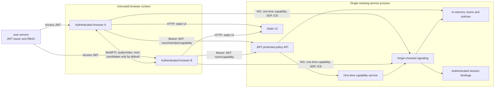
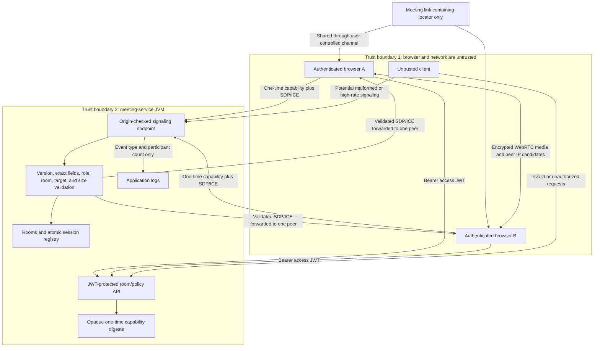
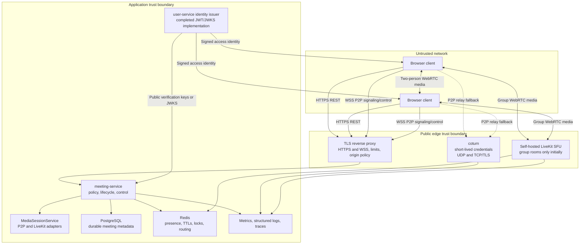

# Video Conferencing Architecture

## Status and scope

This document records the Milestone 0 assessment, Milestone 1 media/signaling hardening, and the
locally implemented Milestone 2 authentication and private-room authorization completed on
2026-08-12. It describes what exists, what is actually verified, the security boundary, and the
selected production direction. The executable status and verification log are maintained in
[`plans/video-conferencing-production-plan.md`](plans/video-conferencing-production-plan.md).

Milestone 2 re-verifies live fake-device media with authenticated users, host-admitted membership,
and one-time signaling capabilities in isolated Chrome contexts on one localhost service.
No claim means that physical devices, separate networks, internet connectivity, TURN relay, or
production capacity have been verified. Those require later milestone gates.

## Repository assessment

### Applicable instructions and repository state

- No `AGENTS.md` exists in the repository, including ignored and hidden paths. The empty `.agents`
  and `.codex` directories contain no additional repository instructions.
- The repository is a Gradle multi-project build with `user-service`, `content-service`, and
  `meeting-service`. The root project also contains a legacy Spring Boot application.
- The checked-out branch is `feature/39-meeting-service`, one commit ahead of the locally available
  `origin/dev`. Refreshing the remote failed because this environment has no GitLab credentials, so
  the remote base is not confirmed current.
- `docs/video-conferencing-production-roadmap.md` was already an untracked user file at the start of
  this milestone and is preserved unchanged.

### Technology and module inventory

| Area | Current implementation |
| --- | --- |
| Backend | Java 21, Spring Boot 3.4.1, Spring WebSocket, Bean Validation, Actuator |
| Build | Gradle wrapper 9.3.0; Checkstyle 10.12.3; GitLab CI builds, tests, runs static checks, and builds Docker images |
| Frontend | Dependency-free HTML, CSS, and native ECMAScript modules served from Spring Boot static resources |
| Frontend tooling | Node-based lint/unit/build scripts plus locked Playwright 1.55.1 browser tests; no bundler or type checker |
| Declared browser support | No explicit browser matrix; the client requires modern WebRTC, media devices, and ES modules |
| Local browser verification | The installed Chrome channel completed two isolated-context fake-camera/fake-microphone calls; Firefox and physical devices were not exercised |
| Meeting persistence | None; rooms, WebSocket sessions, and participant bindings are held in process memory |
| Repository persistence | PostgreSQL and Flyway exist in other services; meeting-service does not use them |
| Redis | Not present as a dependency or Compose service |
| Media infrastructure | Configurable ICE server response exists, but its default is empty; there is no configured STUN, TURN, or SFU |
| Deployment | A non-root multi-stage Docker image and a localhost-bound Compose service exist |
| Edge | No reverse proxy, TLS termination, HTTPS/WSS configuration, or production ingress exists |
| Observability | Actuator exposes health and info; logs are plain application logs; no meeting metrics, traces, dashboards, or structured correlation IDs exist |
| Authentication | user-service issues typed HS256 access/rotating refresh JWTs with issuer, audience, expiry, ID, roles, and replay state; meeting-service validates access tokens and enforces private host/member policy |
| Tests | JUnit 5/Spring Boot/MockMvc/real WebSocket integration tests, Node frontend unit tests, and Playwright Chrome fake-media E2E |
| Existing documentation | `docs/meeting-service.md` documents the local MVP and includes current architecture, sequence, and room-state Mermaid diagrams |

The Node version used for the baseline was 18.19.1 with npm 10.9.8. The documentation currently
states Node 18 or newer, but `package.json` does not enforce an engine or package-manager version.

## Current behavior

### Room domain and lifecycle

`RoomService` stores rooms in a `ConcurrentHashMap`. Each `MeetingRoom` serializes `join`, `leave`,
and `snapshot` operations with intrinsic locking. A room is created empty in `WAITING`, becomes
`ACTIVE` when its second participant joins, returns to `WAITING` when either participant leaves,
and becomes `CLOSED` and is removed when the last participant leaves. The maximum is hard-coded to
two. Empty rooms that have never been joined do not expire and are never removed.

Room IDs are random 128-bit UUID values encoded as 32 hexadecimal characters and are locators, not
authorization. Connection participant IDs are opaque hashes derived from the authenticated user
and room. The creator is `HOST`; only the host can admit or remove a `PARTICIPANT`. Public links are
disabled.

### REST and WebSocket contracts

The Bearer-authenticated REST API provides:

- `POST /api/meetings/rooms` to create a room;
- `GET /api/meetings/rooms/{roomId}` to return status, capacity, count, and creation time;
- `PUT`/`DELETE /api/meetings/rooms/{roomId}/members/{userId}` for host policy;
- `POST /api/meetings/rooms/{roomId}/capabilities` for a 60-second opaque one-time JOIN grant;
- `GET /api/meetings/config` to return ICE server configuration, including username and credential
  fields if configured.

The same-origin WebSocket endpoint is `/ws/meetings`. Version 1 client messages are `JOIN`, `OFFER`,
`ANSWER`, `ICE_CANDIDATE`, `LEAVE`, and `PING`. Server messages are `JOINED`,
`PARTICIPANT_JOINED`, forwarded SDP/ICE messages, `PARTICIPANT_LEFT`, `ROOM_FULL`, `ERROR`, `LEFT`,
and `PONG`.

JOIN consumes a capability scoped to one room and authenticated user. One synchronized registry
atomically reserves room occupancy, derives a server participant ID, and binds connection,
participant, user, role, and room. Later messages derive the sender from that binding. Client `senderId` and
`timestamp` fields are rejected. Exact per-type field sets, integral numeric fields, message/version
allowlists, a 65,536-byte UTF-8 envelope, a 49,152-character SDP, and bounded ICE fields are enforced
before forwarding.

### Negotiation and cleanup

The first participant is selected as the deterministic offerer when the second participant joins;
the server rejects an offer or answer from the wrong role. The browser serializes signaling work,
deduplicates descriptions and candidates, bounds early ICE at 128 entries, and safely ignores stale
peer messages. The media path remains browser-to-browser; the Java service does not receive media
bytes.

Join/send failures have compensating cleanup, and leave/disconnect cleanup is idempotent. The client
stops media tracks and closes its peer connection and WebSocket on explicit leave, server rejection,
or unexpected signaling failure. There is a 30-second client ping, but PONG timing is ignored; the UI
distinguishes reconnecting/degraded/disconnected/failed without claiming automatic reconnect, ICE
restart, or quality adaptation, which remain later milestones.

## Current architecture

There is still no production HTTPS ingress or durable/distributed state. JWT signing uses an
external HS256 secret shared by issuer and verifier; asymmetric public-key verification remains the
target before broadening the service trust boundary. WebSocket origins remain exact localhost URLs.

## Current data flow and trust boundaries

Raw SDP, ICE, IP addresses, room IDs, participant IDs, and session IDs are not intentionally logged
by the signaling handler. ICE candidate exchange still exposes network candidate addresses to the
peer as part of normal P2P WebRTC.

## What can be retained

- The room domain vocabulary and explicit `WAITING`, `ACTIVE`, and `CLOSED` transitions.
- The strict two-participant rule for the P2P mode.
- The rule that occupancy is owned by the signaling session, not duplicated across REST and
  WebSocket endpoints.
- Targeted same-room signaling and server-side derivation of sender identity after binding.
- The overall message-size cap, type allowlist, controlled protocol errors, and avoidance of raw
  signaling payloads in logs.
- Deterministic initial offerer selection and early ICE queuing as a base for a fully specified
  negotiation policy.
- The media-plane separation: media must continue to bypass the Java application backend.
- Constructor injection, UTC `Clock`, DTO-based REST responses, non-root runtime container, and the
  current unit/component test layering.

## What must be corrected

1. Authentication, policy, refresh replay state, capabilities, and limits are process-local.
   HS256 also gives meeting-service signing capability; asymmetric keys/JWKS and key rotation remain.
2. Empty rooms have no TTL. Room creation, capability issuance, and JOIN are limited, but forwarded
   signaling and ordinary REST reads do not yet have dedicated budgets or edge enforcement.
3. Automatic reconnect, heartbeat expiry, ICE restart, and bounded outage recovery are not yet
   implemented. The deterministic two-person role supports controlled renegotiation but is not a
   general multi-peer perfect-negotiation implementation.
4. The config endpoint is authenticated, but configured static ICE credentials would still be
   reusable. There is no STUN/TURN, short-lived TURN credential endpoint, HTTPS, or WSS.
5. The room and session state is single-process and is lost on restart. Multiple replicas would
   diverge and could overfill a room.
6. Signaling logs no longer expose identifiers or payloads, but there is no repository-wide
   redaction enforcement, structured correlation, or low-cardinality meeting telemetry.
7. The UI now has Chrome fake-media E2E coverage but no explicit compatibility matrix,
   network-quality model, adaptive video ladder, or reconnect state machine.
8. Dependency freshness, vulnerabilities, image provenance, and secrets are not scanned by a
   repository-defined security job. Image tags are not pinned by digest.

## Threat model

| Threat | Current exposure | Required control and milestone |
| --- | --- | --- |
| Room ID guessing or unauthorized join | IDs are high entropy locators; authenticated membership is checked before status or capability issuance | Keep public links disabled unless a distinct expiring/revocable invite policy is approved |
| WebSocket/session impersonation | JOIN requires a one-time grant scoped to authenticated user and room; participant identity is derived server-side | Move bindings and nonce state to distributed storage before multiple replicas (M6) |
| Token theft and replay | Access JWTs expire in 15 minutes; refresh JWTs rotate; JOIN capabilities expire in 60 seconds and are one-time; membership revocation evicts an active session | Add asymmetric key rotation, durable/distributed replay state, account-wide revocation, and reconnect refresh (M5-M6) |
| Cross-room signaling | Same-room sender/target checks and tests exist | Retain checks at the domain/application boundary; add authenticated negative tests and distributed routing tests (M1, M2, M6) |
| Malicious SDP/ICE sizes or shapes | Versioned exact schemas, whole-message/per-field limits, integral fields, and bounded/deduplicated client ICE queues are enforced | Add rate budgets and keep protocol fuzz/regression coverage as the schema evolves (M2, M9) |
| Room creation/join/signaling DoS | Per-principal creation/capability and per-IP JOIN limits exist; empty-room TTL, per-signal budgets, distributed limits, and edge enforcement do not | Add TTL cleanup, edge/distributed limits, backpressure, bounded queues, and abuse metrics (M3, M6, M9) |
| TURN resource abuse | TURN is absent; a future static credential would be reusable | Generate short-lived HMAC TURN credentials only for authorized rooms, set allocation/user quotas, firewall rules, monitoring, and expiry (M3) |
| Origin, CORS, and CSRF abuse | WebSocket origins are exact localhost values; REST uses Authorization headers, stateless sessions, no permissive CORS response, and disabled CSRF | Terminate TLS at a trusted edge and define explicit production Host/Origin/CORS policy (M3) |
| Log leakage of tokens, SDP, IPs, or personal data | Signaling logs omit payloads and identifiers; repository-wide redaction enforcement and future credential handling remain unproved | Adopt a sensitive-field denylist, opaque correlation IDs, structured redaction tests, low-cardinality metrics, and retention rules (M2, M9) |
| Dependency or container compromise | Non-root runtime and a frontend lockfile are positive; there is no security scan/SBOM and image tags are not digest-pinned | Scan dependencies/images/secrets, produce an SBOM, pin tested versions/digests, minimize the image, and define patch cadence (M9-M10) |
| Meeting link sharing and revoked access | Query-string room locators are copyable but grant no access; host removal revokes outstanding grants and closes an active session | Keep public invites disabled until their separate expiry/revocation model is approved; add reconnect policy (M5) |
| Inconsistent concurrent session state | One synchronized session registry, compensation, idempotent cleanup, and a concurrent last-slot test protect one process | Preserve these semantics while moving presence atomically to Redis and testing replicas (M6) |
| Backend restart or multi-replica split brain | All state is process-local and no reconnect exists | Add recovery semantics, PostgreSQL metadata, Redis TTL presence/locks, inter-node routing, and two-replica tests before horizontal scale (M5-M6) |

## Architecture decision: P2P for two, LiveKit SFU for groups

### Decision

Retain P2P only for rooms whose fixed capacity is exactly two, after Milestones 1-6 make that path
authenticated, TURN-capable, recoverable, distributed, and observable. Do not let a P2P room change
topology during a call.

For group rooms, use self-hosted LiveKit through official browser and Java/Kotlin server SDKs. The
application will expose a provider-neutral `MediaSessionService` boundary for authorizing a media
session and issuing a short-lived provider credential. Provider room names and API secrets remain
inside the LiveKit adapter. Browsers send media directly to LiveKit, never through meeting-service.

The P2P and SFU modes must share application meeting identity, access policy, participant roles,
presence semantics, audit events, and UI states. The media mode is selected at room creation and is
immutable. A configuration flag can keep SFU group rooms disabled until the Milestone 7 gate passes.

### Why this split is justified

- The existing two-person path is small, direct, and already preserves the correct backend/media
  separation. Hardening it delivers the highest-priority product behavior before operating an SFU.
- TURN closes the largest internet-connectivity gap for P2P without routing media through Java.
- Group mesh is prohibited because upload and peer-connection count grow with participants.
- LiveKit is self-hostable, supplies official client/server SDKs, supports room-scoped access grants,
  documents TURN and production deployment, and has a Redis-backed distributed mode with draining.
- Janus provides a capable VideoRoom SFU but exposes a lower-level plugin/session protocol that would
  require more custom orchestration. Jitsi is a broader React/XMPP/Jicofo/Videobridge product stack
  that duplicates this application's UI and room domain. mediasoup is intentionally a low-level
  Node.js module and would require a new server runtime plus custom signaling and operations.
- Two media adapters add complexity, but it is bounded by immutable room mode and a narrow internal
  interface. Before Milestone 7, operational evidence may still justify migrating two-person rooms
  to LiveKit; that would be a new ADR and gate, not an implicit change.

Official references used for this decision:

- [LiveKit self-hosting](https://docs.livekit.io/transport/self-hosting/)
- [LiveKit distributed deployments](https://docs.livekit.io/transport/self-hosting/distributed/)
- [LiveKit token grants](https://docs.livekit.io/home/server/generating-tokens)
- [LiveKit Java/Kotlin server SDK](https://github.com/livekit/server-sdk-kotlin)
- [Janus VideoRoom](https://janus.conf.meetecho.com/docs/videoroom.html)
- [Jitsi architecture](https://jitsi.github.io/handbook/docs/architecture/)
- [mediasoup design](https://mediasoup.org/documentation/v3/mediasoup/design/)

Self-hosted LiveKit token expiry is primarily a connection-time control, so application-level
revocation must also deny refresh/rejoin and actively remove a connected participant when policy is
revoked. This limitation must be tested rather than hidden behind token TTL alone.

## Target production architecture

PostgreSQL stores meeting identity, owner, access policy, immutable media mode, lifecycle timestamps,
and audit-safe facts. Redis stores active presence, short-lived session mappings, heartbeats, locks,
and routing hints. Neither store may contain SDP, ICE candidates, media, access tokens, or TURN
credentials. Provider-specific LiveKit state remains behind the media adapter.

## Verification verdict

Milestone 2 passed on 2026-08-12. The backend gate executed 82 user-service tests and 43
meeting-service tests with Checkstyle and `bootJar`; frontend lint, 12 unit tests, build, and npm
audit passed. Two authenticated isolated Chrome contexts reached `Connected` and each received one
live audio and video track. The same suite proved an authorized third user's capacity rejection and
slot reuse after refresh. Negative tests cover anonymous/cross-user access, issuer/audience/type,
expiry/skew, refresh rotation/replay, RBAC, capability expiry/scope/replay/revocation, active
eviction, impersonation-resistant participant identity, and rate limits.

This is local deterministic media evidence, not production connectivity evidence. It does not prove
physical devices, Firefox/Safari compatibility, two machines, codec diversity, NAT traversal,
TURN, weak networks, automatic recovery, distributed state, key rotation, or operational load.

P2P is sufficient for the two-participant product path only after the security, consistency, TURN,
recovery, and observability gates pass. It is not sufficient for group calls.
